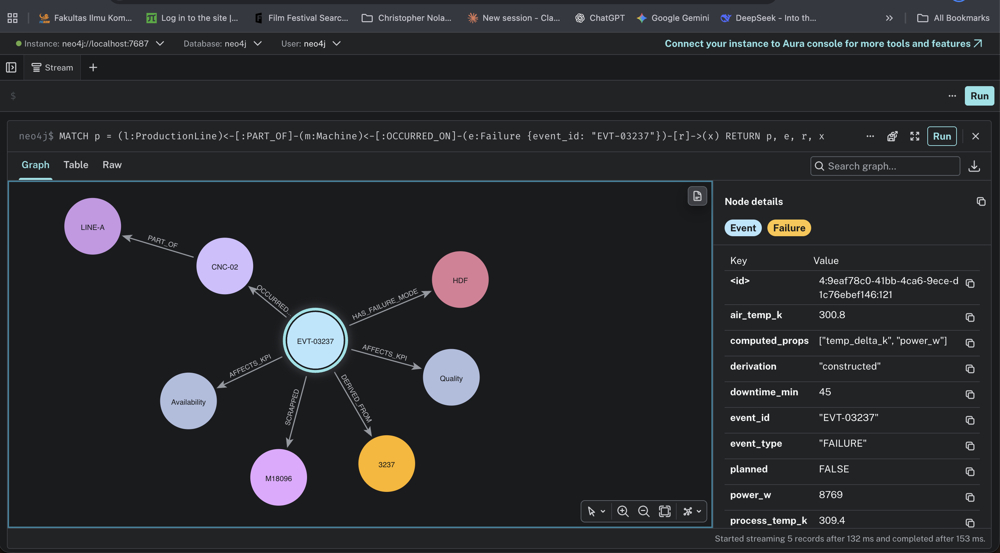

# IIoT Maintenance Knowledge Graph

Linking CNC failure events to manufacturer troubleshooting knowledge.

Course project for **Knowledge Graphs and LLMs** (Prof. R. V. Davydov), Peter the Great St. Petersburg
Polytechnic University, 2026. Author: Putra Ovriawan Aldo Pribadi, group 5140901/51701.

The graph connects structured failure events (built from the AI4I 2020 dataset) with facts extracted
from Haas Automation troubleshooting guides, so a maintenance engineer can see which components to
inspect and which actions to take after a machine fails. The full plan is in `docs/proposal/proposal_v6.pdf`.

## Status

| Stage | Deadline | Status |
|---|---|---|
| Proposal | 3 Nov 2026 | Accepted |
| Task 1: initial graph from structured data | 1 Dec 2026 (discussion 17 Nov) | In progress: build, load, checks, Q1-Q6 |
| Task 2: knowledge extracted from text | Credit day (discussion 15 Dec) | Not started |

## Repository structure

```
data/
  raw/            original sources (AI4I 2020, pilot Haas passages)
  constructed/    events.csv, machines.csv, rejected_records.csv (built by scripts/build_events.py)
scripts/          Python scripts that build the data and the graph
cypher/           constraints and the Cypher queries (Task 1: Q1-Q6)
results/          saved query results and the proposal-number check
reports/          graph check report, statistics, manual verification sample
graph_export/     saved Task 1 graph (nodes and relationships as CSV)
notebooks/        Jupyter notebooks for exploration and the defence demo
docs/
  proposal/       accepted project proposal (PDF)
  schema/         schema diagram
  figures/        Neo4j Browser screenshots of the Task 1 graph
```

## Data sources

| Source | Use | Licence / access |
|---|---|---|
| AI4I 2020 Predictive Maintenance Dataset, Matzka (2020), UCI ML Repository, doi:10.24432/C5HS5C | Structured records (Task 1) | CC BY 4.0, unchanged copy in `data/raw/ai4i2020.csv` |
| Haas Automation troubleshooting guides (TG0009, TG0051, Standard Coolant NGC, ...), haascnc.com | Unstructured text (Task 2) | Public web pages, (c) Haas Automation: only URLs, retrieval dates, passage IDs and short excerpts are stored |

AI4I 2020 is a published synthetic benchmark that reflects real industrial predictive-maintenance data.
See `data/README.md` for column descriptions.

## Rebuild

Requirements: Python 3.11+, and Neo4j 5 (Docker or Neo4j Desktop).

```bash
python3 -m venv .venv
source .venv/bin/activate
pip install -r requirements.txt

# Neo4j 5 in Docker (works on Apple Silicon); browser at http://localhost:7474
docker run -d --name kg-neo4j -p 7474:7474 -p 7687:7687 \
  -e NEO4J_AUTH=neo4j/password123 neo4j:5-community
export NEO4J_PASSWORD=password123      # also NEO4J_URI, NEO4J_USER, NEO4J_DATABASE if not default

./run_all.sh                           # every step below, in order
```

| Step | Command | Output |
|---|---|---|
| 1 Build events | `python scripts/build_events.py` | `data/constructed/events.csv`, `machines.csv`, `rejected_records.csv` |
| 2 Load graph | `python scripts/load_graph.py --reset`, then once more without `--reset` | Neo4j graph; the second run must print "counts unchanged" |
| 3 Check graph | `python scripts/check_graph.py` | `reports/checks_report.md`, `graph_stats.json`, `manual_verification_sample.csv` |
| 4a Answers from CSV | `python scripts/answers_pandas.py` | `results/qN_pandas.csv`, `results/proposal_numbers_check.txt` |
| 4b Answers from graph | `python scripts/run_queries.py` | `results/qN_neo4j.csv`, `results/comparison.md` |
| 5 Save graph | `python scripts/export_graph.py` | `graph_export/task1_nodes.csv`, `task1_relationships.csv` |

Expected output of step 1: `458 (339 FAILURE + 119 TOOL_CHANGE)`, 9 UNSPECIFIED failures, 18 rejected rows.
Expected graph after step 2: **1,270 nodes and 2,763 relationships**.
`python scripts/load_graph.py --dry-run` shows what would be written without a database.

## Task 1 design

### Schema (Task 1 part of Figure 1 in the proposal)

```
(:Event:Failure | :Event:ToolChange)
    -[:OCCURRED_ON]->      (:Machine) -[:PART_OF]->     (:ProductionLine)
                                      -[:INSTANCE_OF]-> (:MachineModel)
    -[:HAS_FAILURE_MODE]-> (:FailureMode)                        failures only
    -[:AFFECTS_KPI {downtime_min | scrap_parts}]-> (:KPI)
    -[:SCRAPPED]->         (:Product) -[:OF_VARIANT]-> (:ProductVariant)   failures only
    -[:DERIVED_FROM]->     (:SourceRecord)                       provenance: AI4I row
```

| Label | Count | Relationship | Count |
|---|---|---|---|
| Event (Failure 339, ToolChange 119) | 458 | OCCURRED_ON | 458 |
| SourceRecord | 455 | DERIVED_FROM | 458 |
| Product | 339 | HAS_FAILURE_MODE | 364 |
| FailureMode | 6 | AFFECTS_KPI | 797 |
| Machine | 4 | SCRAPPED | 339 |
| ProductVariant | 3 | OF_VARIANT | 339 |
| ProductionLine | 2 | PART_OF | 4 |
| KPI | 2 | INSTANCE_OF | 4 |
| MachineModel | 1 | | |

458 events but 455 source records: in UDI 5491, 6679 and 9176 the tool was changed in the same
cycle as a failure, so one AI4I row produces two events (`TC-` and `EVT-`).

### Stable identifiers

| Label | Key | Example | Origin |
|---|---|---|---|
| Event | `event_id` | `EVT-03237`, `TC-03275` | `EVT-`/`TC-` + 5-digit AI4I UDI |
| SourceRecord | `udi` | `3237` | AI4I UDI (+ `file`, `row` = line in the CSV) |
| Machine | `machine_id` | `CNC-02` | `machines.csv`: 2,500 consecutive UDIs per machine |
| ProductionLine | `line_id` | `LINE-A` | CNC-01/02 -> LINE-A, CNC-03/04 -> LINE-B |
| MachineModel | `model_id` | `HAAS-VF2` | assumption stated in the proposal |
| FailureMode | `code` | `HDF` | AI4I flag name; `UNSPECIFIED` for failures without a flag |
| KPI | `kpi_id` | `Availability`, `Quality` | ISO 22400-2 (Quality = quality ratio) |
| Product | `product_id` | `M18096` | AI4I Product ID |
| ProductVariant | `code` | `L`, `M`, `H` | AI4I Type |

Each key has a uniqueness constraint (`cypher/00_constraints.cypher`) and every write is a `MERGE` on that key.

### Node or property?

- **Node**: things that many events share and that the questions traverse: Machine, ProductionLine,
  FailureMode, KPI, ProductVariant, MachineModel. FailureMode as a node lets one event carry two modes
  (Q4) and lets Task 2 attach text symptoms to the same node.
- **Property**: values of one event only: sensor readings, timestamp, downtime, power.
- **Product** is a node only for the 339 scrapped products, because Q3 and Q5 go
  Event -> Product -> ProductVariant. For tool changes `product_id` stays a property.
- **Relationship property**: the KPI loss of an event (`downtime_min` on the Availability edge,
  `scrap_parts` on the Quality edge), because it describes that event-KPI pair.

### Provenance

Every node and relationship has `source` and `derivation`:
`stated` = value present in AI4I; `computed` = arithmetic on AI4I values (`temp_delta_k`, `power_w`,
listed in `Event.computed_props`); `constructed` = my rule (machine, line, timestamp, downtime, KPI).
`(:Event)-[:DERIVED_FROM]->(:SourceRecord {udi, file, row})` leads from any event back to its CSV line.

### Construction rules (proposal, section 03-B)

| Column | Rule |
|---|---|
| machine_id, line_id | UDI 1-2500 CNC-01, 2501-5000 CNC-02 (LINE-A); 5001-7500 CNC-03, 7501-10000 CNC-04 (LINE-B) |
| timestamp | per machine, from 2026-10-01 06:00, one row = one 5-minute cycle |
| FAILURE event | `Machine failure` = 1 |
| TOOL_CHANGE event | tool wear lower than in the previous row of the same machine; `tool_wear_before_min` keeps the wear before the reset |
| downtime_min | TWF 25, HDF 45, PWF 60, OSF 35, RNF/UNSPECIFIED 15; several modes -> the largest; tool change 10 |
| kpi_affected, scrap_parts | failure: Availability + Quality, 1 scrapped part; tool change: Availability, 0 |

`events.csv` keeps the Checkpoint 1 columns and row order; Task 1 appends `source_file`, `source_row`
and `tool_wear_before_min`.

### Records that do not fit, duplicates, repeated imports

- Missing or non-numeric values, flags other than 0/1, unknown product type, duplicate UDI, UDI outside
  1-10000: rejected with a reason in `rejected_records.csv` (none occur in AI4I, but the checks run).
- A failure-mode flag while `Machine failure` = 0 (18 rows, all RNF): no event, rejected with
  reason "mode flag without machine_failure".
- `Machine failure` = 1 with no mode flag (9 rows): kept, linked to FailureMode `UNSPECIFIED`
  (derivation constructed).
- Repeated imports: `MERGE` on constrained keys; `load_graph.py` prints counts before and after.

## Task 1 checks (`reports/checks_report.md`)

C1 identifier uniqueness, C2 required properties, C3 relationship types and endpoint labels,
C4 cardinalities (each event one machine and one source row, failures at least one mode, ...),
C5 source and derivation on every node and relationship, C6 graph counts equal to `events.csv`.
Manual check: `reports/manual_verification_sample.csv` lists 20 random events (seed 2026) with the graph
values next to the raw AI4I values; I open each AI4I row and write OK/WRONG in `checked_by_hand`.

## Task 1 graph in Neo4j Browser

Failure event EVT-03237 with its machine, line, failure mode, KPIs, scrapped product and AI4I source row
(query: `MATCH p = (l:ProductionLine)<-[:PART_OF]-(m:Machine)<-[:OCCURRED_ON]-(e:Failure {event_id: "EVT-03237"})-[r]->(x) RETURN p, e, r, x`).

| Screenshot | Shows |
|---|---|
| [`task1_graph_event_evt03237_1.png`](docs/figures/task1_graph_event_evt03237_1.png) | event properties, part 1: `derivation = constructed`, downtime, computed properties |
| [`task1_graph_event_evt03237_2.png`](docs/figures/task1_graph_event_evt03237_2.png) | event properties, part 2: AI4I sensor values (`sensor_values_derivation = stated`), source, timestamp |
| [`task1_graph_failuremode_hdf.png`](docs/figures/task1_graph_failuremode_hdf.png) | FailureMode HDF with the AI4I rule and its source |



## Task 1 questions

| # | Question | Domain path | Answer (results/) |
|---|---|---|---|
| Q1 | Which line lost the most unplanned downtime, and which failure mode contributed most there? | Line <- Machine <- Event -> FailureMode | LINE-A 10,505 min in 235 failures; top mode HDF 5,220 min |
| Q2 | On which machines do HDF failures occur, and under which process conditions? | FailureMode <- Event -> Machine -> Line | only CNC-02: 115 events, max ΔT 8.6 K, max 1,379 rpm |
| Q3 | Which product variant is scrapped most by OSF on each line? | Variant <- Product <- Event -> FailureMode; Event -> Machine -> Line | L: 87 of 98 (LINE-A 48, LINE-B 39); M 9, H 2 |
| Q4 | Which failure modes occur together in one event, and on which machines? | FailureMode <- Event -> FailureMode; Event -> Machine | 24 events; OSF+PWF 11 on all machines; all 9 with HDF on CNC-02 |
| Q5 | How do PWF failures split into low- and high-power cases, by line and variant? | as Q3 | 64 high (> 9000 W), 31 low (< 3500 W) |
| Q6 | Per machine, how many tool changes and TWF failures, and at what tool wear? | Machine <- Event -> FailureMode | 29/30/29/31 changes, 8/13/12/13 TWF; TWF at 198-253 min |

Each query is in `cypher/`. `run_queries.py` saves the Cypher result and compares it with an independent
pandas calculation on `events.csv` (`results/comparison.md`). `results/proposal_numbers_check.txt`
compares the data with every number written in the proposal.

## Limitations

- AI4I is a published synthetic benchmark; machine, line, timestamp and downtime values are my
  construction (`derivation = constructed`), so minute totals illustrate the method, not a real plant.
- Q4 counts exact mode combinations: the one TWF+PWF+OSF event is not counted under OSF+PWF.
- AI4I documents TWF between 200 and 240 min, but TWF occurs at 198-253 min in the data and tool
  changes at up to 253 min (Q6); reported as a data-quality finding, not corrected.
- `power_w` is rounded to whole watts; a value within 0.5 W of 3500 or 9000 W could change its Q5 class.

## Use of AI tools

Claude (Anthropic) assisted with planning, drafting the proposal and writing scripts. I reviewed, ran and verified all code and results myself. No LLM output is a fact in the Task 1 graph: every fact comes from `ai4i2020.csv` or a documented construction rule. If an LLM is used for extraction in Task 2 (planned: Llama 3.1 8B via Ollama, temperature 0), the model version, run dates, settings, prompts and raw outputs will be saved in this repository so the graph can be rebuilt without new model calls.
